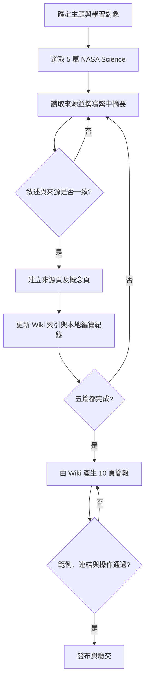

# 星球小百科｜LLM Wiki → HTML 教學簡報流程

## 一、設計目的與「先討論、後生成」
本次主題為「太陽系五顆行星」，初版範圍只選水星、金星、地球、火星與木星，目標讀者是天文零基礎者。來源統一採用 NASA Science 的五篇 Facts，避免資料過於分散。

## 二、Loop / Graph

### 哪些步驟重複執行？
- **來源迴圈：** 一份 NASA Facts → 摘要 → 概念頁 → 索引；對 S01 至 S05 重複。
- **檢查迴圈：** 若簡報用詞不對、連結失效、按鈕不工作，就回到 Wiki 或簡報重查並更新。

## 三、可追溯的三道檢查

| 關卡 | 放在哪裡 | 檢查內容 |
|---|---|---|
| A. 資料正確性 | 建立 Wiki 前 | NASA 來源是否支持行星順序、類型與主要事實 |
| B. Wiki 與簡報一致性 | 簡報生成後 | 每張行星投影片是否有對應的 Wiki 概念頁與來源 |
| C. 網站功能 | 發布前 | 能否翻頁、顯示小測驗答案、開啟 Wiki 頁面及來源連結 |

## 四、這次實際核對的概念

- **金星與水星：** 最近太陽的是水星，但表面最熱的是金星；NASA 的 Venus 與 Mercury Facts 可分別支持。
- **地球的生命敘述：** 使用「目前唯一已確認有生命」，避免誤說其他地方絕不可能有生命。
- **火星的顏色：** 說明為含鐵物質氧化造成紅色外觀，不只用「火星就是紅色」當原因。
- **木星的表面：** 改用 NASA 的「沒有真正的固體表面」，不要畫成可站立的岩石地面。

## 五、反思與需要提前的檢查

最容易出錯的是「由 NASA 英文資料縮寫成中文摘要」以及「由 Wiki 簡化成投影片」兩個轉換點。例如金星／水星誰最熱的問題，若只用離太陽遠近推論，就會答錯；因此要**在建立 Wiki 前就核對來源**。接著在簡報生成後檢查是否和 Wiki 一致，而不是只看頁面是否漂亮。

**執行證據：** 本專案有五份 raw 筆記、五份來源條目、五份概念 Markdown、對應的 HTML Wiki 頁面、十張投影片與本地編纂紀錄。程式與互動測試可另在 `CHECKS.md` 查看。若學生於 GitHub Pages 實際測試，請將真實截圖或結果補入繳交稿。

## 六、後續增加第六篇資料

回原來源核對 → 建立 `raw/` 新摘要 → 建立 `wiki/sources/` 與 `wiki/concepts/` → 更新 `wiki/index.md` 和 `wiki/log.md` → 更新簡報 → 重新測試。這個流程可重複用於其他行星。
